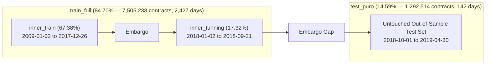

# Data Layer & Methodology Guide

This document describes the data architecture, primary sources, quantitative filtering criteria, variable dictionary, train/test temporal split design, and dataset generation pipeline used in this thesis.

---

## 1. Directory Layout & Pipeline Flow

The repository adheres to a strict separation between raw data sources and clean, processed modeling datasets:

```
02_data/
├── README.md                      <- Data layer specification (this document)
├── splits_meta.json               <- Temporal split metadata and sample statistics
├── raw/                           <- Raw input files (local-only, ignored by Git)
│   ├── SPX_CBOE/                  <- Daily CBOE Option EOD Summary CSV files (2009–2019)
│   └── Fred_IR/                   <- Federal Reserve Constant Maturity Treasury yields
└── processed/                     <- Serialized modeling datasets (local-only, ignored by Git)
    ├── df_train_full.parquet      <- Complete training set (2009–2018)
    ├── df_inner_train.parquet     <- Inner train split for hyperparameter tuning
    ├── df_inner_tunning.parquet   <- Inner validation split for model selection
    ├── df_test_puro.parquet       <- Strictly untouched out-of-sample test set (2018–2019)
    └── df_IR.parquet              <- Pre-interpolated continuous risk-free rate curves
```

> [!NOTE]
> **Data Access & Proprietary Rights:**  
> The raw daily options dataset is commercially licensed by the Chicago Board Options Exchange (CBOE) and cannot be distributed publicly. If you have institutional access to CBOE Option EOD data and FRED interest rate series, placing them in `02_data/raw/` enables full end-to-end execution of the data exploration and preprocessing notebooks in `03_notebooks/01_exploration/`.

---

## 2. Primary Data Sources

1. **CBOE Option EOD Summary (SPX Options):**
   * **Underlying Asset:** S&P 500 Index (`SPX`).
   * **Contract Types:** European-style Calls and Puts.
   * **Period Covered:** January 2, 2009 to April 30, 2019 (over 10 consecutive years).
   * **Observation Frequency:** Daily end-of-day market quotes (15:45 EST benchmark).
   * **Raw Volume:** Over 11.6 million original option records.

2. **Federal Reserve Economic Data (FRED):**
   * **Series:** U.S. Constant Maturity Treasury (CMT) Yield Curves.
   * **Tenors:** 1-month (`DGS1MO`), 3-month (`DGS3MO`), 6-month (`DGS6MO`), 1-year (`DGS1`), 2-year (`DGS2`), 3-year (`DGS3`), 5-year (`DGS5`), 7-year (`DGS7`), 10-year (`DGS10`), 20-year (`DGS20`), 30-year (`DGS30`).
   * **Methodology:** Daily yield curves are interpolated using cubic splines and piecewise linear interpolation to compute the exact continuous risk-free rate `r` matching each option's time to expiration `T`.

---

## 3. Quantitative Filtering & Quality Criteria

To ensure market microstructure robustness and prevent bias from numerical inversion artifacts, a rigorous multi-stage filtering protocol is applied:

1. **Liquidity & Non-Zero Bid Filter:**  
   Contracts with `Bid <= 0` or non-positive spreads are discarded to eliminate quotes where no executable market exists.
2. **Spread Consistency & Arbitrage Bounds:**  
   Contracts violating elementary arbitrage bounds (`Bid > Ask` or negative spreads) are filtered out.
3. **Maturity Horizons:**  
   Options with extreme short maturities (`T < 7 days`, prone to expiration-week noise and jump risks) or ultra-long maturities (`T > 2.5 years`, illiquid) are excluded.
4. **Theoretical IV Inversion & Bounds:**  
   Implied volatility is computed by inverting the Black-Scholes formula using the Newton-Raphson algorithm. Observations where the solver fails (NaN) or yields extreme non-economic values (`IV <= 0` or `IV > 2.0`, corresponding to annualized volatility > 200%) are excluded. These predominantly affect deep out-of-the-money (OTM) options with negligible trading volume.
5. **Final Modeling Universe:**  
   After all filtering criteria, the clean dataset comprises **8,860,820 high-quality contracts** across **2,577 trading days**.

---

## 4. Variable Dictionary (Dataset Schema)

The final modeling dataset contains 11 variables capturing contract terms, underlying market state, and target volatility:

| Column Name      | Role in Models    | Data Type | Sample Value | Description |
| :--------------- | :---------------: | :-------: | :----------: | :---------------------------------------------------------- |
| `quote_date`     | Timestamp         | date      | 2018-10-01   | Market quote observation date (YYYY-MM-DD)                  |
| `expiration`     | Timestamp         | date      | 2018-12-21   | Option contract settlement / expiration date                |
| `T`              | **Core Feature**  | float     | 0.2219       | Time to maturity in years: (expiration - quote_date) / 365  |
| `S`              | Market State      | float     | 2918.58      | Underlying S&P 500 spot mid price at 15:45 EST (USD)        |
| `K`              | Contract Term     | float     | 3065.00      | Option contract strike price (USD)                          |
| `option_price`   | Market State      | float     | 148.80       | Option contract mid price: (Bid + Ask) / 2 (USD)            |
| `moneyness`      | Reference Ratio   | float     | 1.0502       | Simple strike-to-spot ratio: K / S                          |
| `log_moneyness`  | **Core Feature**  | float     | 0.0490       | Normalized log-moneyness: m = ln(K / S)                     |
| `risk_free_rate` | Exogenous State   | float     | 0.0221       | Annualized continuous risk-free rate from FRED CMT curve    |
| `option_is_call` | **ML Feature**    | integer   | 0            | Binary option type indicator: 1 = Call, 0 = Put             |
| `iv_teorica`     | **Target (y)**    | float     | 0.1110       | **Target Variable:** Black-Scholes implied volatility (IV)  |

* **Classical Models (OLS, Polynomial, Splines):** Predict `iv_teorica` using `(log_moneyness, T)`.
* **Machine Learning & Hybrid Models (RF, XGBoost):** Predict `iv_teorica` using `(log_moneyness, T, option_is_call)`.

---

## 5. Temporal Train / Validation / Test Splits

In financial time-series modeling, standard random cross-validation introduces severe lookahead bias and autocorrelation leakage. We enforce a **strict chronological partition with an embargo period**:



### Split Statistics Breakdown (`splits_meta.json`)

| Dataset Partition  | Start Date | End Date   | Trading Days | Observation Count | Share of Total | Purpose |
| :----------------- | :--------: | :--------: | :----------: | :---------------: | :------------: | :-------------------------------------------------- |
| **`inner_train`**   | 2009-01-02 | 2017-12-26 | 2,244        | 5,970,843         | 67.38%         | Primary model estimation and parameter calibration. |
| *Inner Embargo*    | 2017-12-27 | 2018-01-01 | 3            | —                 | —              | Purge overlap between inner train and inner tuning. |
| **`inner_tunning`** | 2018-01-02 | 2018-09-21 | 183          | 1,534,395         | 17.32%         | Hyperparameter optimization (Grid/Random Search).   |
| **`train_full`**    | 2009-01-02 | 2018-09-21 | 2,427        | 7,505,238         | 84.70%         | Final retraining of selected optimal models.        |
| *Test Embargo*     | 2018-09-22 | 2018-09-30 | 5            | —                 | —              | Purge overlap before out-of-sample evaluation.      |
| **`test_puro`**     | 2018-10-01 | 2019-04-30 | 142          | 1,292,514         | 14.59%         | **Strict out-of-sample generalization benchmark.**  |
| **Total Universe**  | 2009-01-02 | 2019-04-30 | 2,577        | 8,860,820         | 100.00%        | Comprehensive SPX options dataset.                  |

---

## 6. Preprocessing & Generation Flow

The processed datasets are produced deterministically through the following sequence of notebooks:

1. **`03_notebooks/01_exploration/01_data_loading.ipynb`:**  
   Ingests daily CBOE CSV files, validates initial schemas, and consolidates raw option records into indexed Parquet format.
2. **`03_notebooks/01_exploration/02_data_cleaning_filtering.ipynb`:**  
   Applies microstructure bid-ask filters, computes moneyness $m$ and maturity $T$, and removes non-executable quotes.
3. **`03_notebooks/01_exploration/04_interest_rates_curves.ipynb`:**  
   Parses FRED Treasury yields and constructs continuous risk-free rate curves matching option tenors (`df_IR.parquet`).
4. **`03_notebooks/02_features_universe/01_modeling_universe_splits.ipynb`:**  
   Merges options with interest rates, computes theoretical implied volatility via Newton-Raphson, filters numerical outliers, enforces the chronological splits with embargo gaps, and exports the final modeling datasets (`df_train_full`, `df_inner_train`, `df_inner_tunning`, `df_test_puro`, and `splits_meta.json`).

