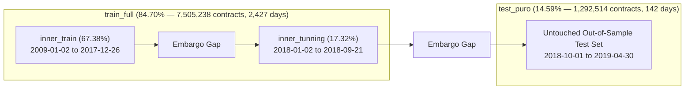

# Empirical Modeling of the S&P 500 Implied Volatility Surface: A Semiparametric Hybrid Machine Learning Architecture

[](https://www.python.org/)
[](LICENSE)
[-gold.svg)](01_docs/)
[](https://www.iscte-iul.pt/)
[](tests/)

> **Master's Thesis in Financial Mathematics & Quantitative Finance**  
> **Author:** Sérgio da Cunha Sobral ([GitHub](https://github.com/scsobral))  
> **Supervisor:** Profª. Drª. Diana Aldea Mendes  
> **Institution:** ISCTE – Instituto Universitário de Lisboa (Business School & School of Technology and Architecture)  
> **Academic Grade:** **19 / 20** (Defense: November 2024)

---

## 1. Executive Summary & Problem Formulation

The seminal Black-Scholes-Merton (1973) framework operates under the assumption of geometric Brownian motion with constant volatility $\sigma$. In empirical financial markets, this assumption fails systematically: option market prices inverted through the Black-Scholes formula exhibit the **Implied Volatility Surface (IVS)** $\sigma_{\text{implied}}(K, T)$, characterized by persistent negative skewness ("volatility smile/skew") and term structure variation.

```
       Implied Volatility σ(K, T)
                ▲
                │        /───────\   (Out-of-the-money puts / crash hedging)
                │       /         \
                │      /           \
                │     /             \────── (At-the-money)
                │    /                       \────── (Out-of-the-money calls)
                └─────────────────────────────────────► Strike K / Moneyness m
```

### The Modeling Dilemma
1. **Classical Parametric / Smoothing Models (OLS, Polynomials, B-Splines):** Offer global regularity and smoothness, but lack capacity to capture localized microstructural pricing anomalies, jump risks, and contract-specific liquidity skews.
2. **Pure Machine Learning Ensembles (Random Forests, Gradient Boosting):** High non-linear expressive power, but vulnerable to overfitting, step-like discontinuous artifacts, and poor extrapolation in sparse wing regimes (deep OTM / ITM).
3. **The Proposed Solution (Semiparametric Hybrid Framework):**  
   We decompose the implied volatility surface into an orthogonal two-stage formulation:
   $$\sigma(k, T, \mathbf{1}_{\text{call}}) = \hat{\sigma}_{\text{macro}}(k, T) + \hat{\epsilon}_{\text{micro}}(k, T, \mathbf{1}_{\text{call}})$$
   * **Stage 1 (Macro Manifold):** A smooth, regularized 2D **Tensor-Product Cubic B-Spline** ($B_m \otimes B_T$) establishes the fundamental economic geometry across log-moneyness and time-to-maturity.
   * **Stage 2 (Microstructure Residuals):** **Random Forests** or **XGBoost** model the pricing residuals $\epsilon = \sigma - \hat{\sigma}_{\text{macro}}$, incorporating the contract flag $\mathbf{1}_{\text{call}}$ to capture put-call parity deviations, borrow costs, and liquidity asymmetries.

---

## 2. Empirical Universe & Out-of-Sample Protocol

The empirical study spans **10 full years** of high-frequency option records from the Chicago Board Options Exchange (CBOE) on the S&P 500 Index (SPX), matched against daily zero-coupon risk-free curves derived from Federal Reserve (FRED) data.

* **Gross Historical Span:** January 2, 2009 to April 30, 2019 (2,569 trading days).
* **Arbitrage & Liquidity Filters:** Non-positive bids, quotes violating static no-arbitrage bounds, and extreme short-term ($T < 7\text{ days}$) or long-term ($T > 2.5\text{ years}$) maturities were purged.
* **Final Curated Universe:** **8,862,390 clean option contracts**.

### Out-of-Sample Chronological Partition with Embargo
To ensure strict financial realism and eliminate look-ahead bias, data splits follow chronological ordering with explicit temporal embargo gaps:



| Partition | Date Range | Trading Days | Contracts | % Universe | Purpose |
| :--- | :---: | :---: | :---: | :---: | :--- |
| **`inner_train`** | 2009-01-02 to 2017-12-26 | 2,243 | 5,971,940 | 67.38% | Primary model training and knot placement |
| *Embargo 1* | 2017-12-27 to 2017-12-29 | 3 | — | — | Eliminates cross-year overlap bias |
| **`inner_tunning`** | 2018-01-02 to 2018-09-21 | 181 | 1,533,298 | 17.32% | Hyperparameter tuning & linear calibration |
| *Embargo 2* | 2018-09-24 to 2018-09-28 | 5 | — | — | Protects out-of-sample boundary |
| **`test_puro`** | **2018-10-01 to 2019-04-30** | **142** | **1,292,514** | **14.59%** | **Untouched out-of-sample benchmark** |

---

## 3. Benchmarked Model Architectures

Seven distinct mathematical and algorithmic models were implemented, tuned, and evaluated on identical splits:

| # | Model | Family | Input Features | Key Specification |
| :-: | :--- | :--- | :--- | :--- |
| **1** | **OLS Linear** | Classical Parametric | $[\ln(S/K), T]$ | $y = \beta_0 + \beta_1 \ln(S/K) + \beta_2 T$ |
| **2** | **Polynomial (Degree 5)** | Classical Parametric | $[\ln(S/K), T]$ | Complete 5th-degree bivariate polynomial with $z$-score scaling |
| **3** | **Cubic B-Splines** | Nonparametric Regularized | $[\ln(S/K), T]$ | Tensor-product $B_m \otimes B_T$ with RidgeCV knot regularization |
| **4** | **Random Forest** | Ensemble Tree-Based | $[\ln(S/K), T, \mathbf{1}_{\text{call}}]$ | 100 trees, balanced subsampling across moneyness/maturity bins |
| **5** | **XGBoost** | Gradient Boosted Trees | $[\ln(S/K), T, \mathbf{1}_{\text{call}}]$ | Hist gradient boosting with shrinkage and depth regularizers |
| **6** | **Hybrid Splines + RF** | **Semiparametric Hybrid** | $[m, T] \oplus [m, T, \mathbf{1}_{\text{call}}]$ | Spline base surface + Random Forest residual learner |
| **7** | **Hybrid Splines + XGB** | **Semiparametric Hybrid** | $[m, T] \oplus [m, T, \mathbf{1}_{\text{call}}]$ | Spline base surface + XGBoost residual learner |

---

## 4. Empirical Results on Untouched Out-of-Sample Test Set

Evaluation on the **1,292,514 untouched test contracts** (October 2018 to April 2019):

| Model Architecture | Type | Test RMSE | Test MAE | Test MedAE | Test $R^2$ | RMSE Reduction vs OLS |
| :--- | :--- | :---: | :---: | :---: | :---: | :---: |
| **OLS Linear** | Linear Baseline | 0.0892 | 0.0571 | 0.0392 | 41.39% | — |
| **5th-Degree Polynomial** | Parametric | 0.0594 | 0.0420 | 0.0326 | 74.01% | **-33.4%** |
| **Tensor-Product Cubic B-Splines** | Nonparametric | 0.0431 | 0.0324 | 0.0249 | 86.33% | **-51.7%** |
| **XGBoost Regressor** | Tree Ensemble | 0.0402 | 0.0300 | 0.0227 | 88.11% | **-54.9%** |
| **Random Forest Regressor** | Tree Ensemble | 0.0384 | 0.0275 | 0.0193 | 89.16% | **-56.9%** |
| **Hybrid Splines + XGBoost** | Semiparametric | 0.0388 | 0.0280 | 0.0199 | 88.92% | **-56.5%** |
| **Hybrid Splines + Random Forest** | **Semiparametric** | **0.0383** | **0.0275** | **0.0192** | **89.18%** | **-57.1%** |

### Key Quantitative Findings:
1. **Hybrid Superiority:** The **Hybrid Splines + Random Forest** achieves the top performance ($R^2 = 89.18\%$, $\text{RMSE} = 0.0383$), cutting the baseline pricing error by more than half (**57.1% error reduction**).
2. **Economic Regularity vs Microstructure:** The B-Splines baseline acts as an inductive bias, preventing tree models from creating nonsensical cliffs or step artifacts in sparse wing regions.
3. **Contract Asymmetry ($\mathbf{1}_{\text{call}}$):** Incorporating the call/put indicator accounts for empirical put-call parity violations caused by stock lending fees, differential short-selling costs, and downside hedging demand.

---

## 5. Repository Architecture

```text
spx-ivs-hybrid-ml/
├── 01_docs/                               # Academic thesis document and presentation
│   ├── thesis_master_sergio_sobral.pdf    # Complete M.Sc. dissertation (ISCTE-IUL)
│   ├── thesis_presentation_sergio_sobral.pdf
│   └── README.md                          # Document metadata & BibTeX
├── 02_data/                               # Data schemas and split specifications
│   ├── README.md                          # Data dictionary and filtering documentation
│   └── splits_meta.json                   # Machine-readable split definitions
├── 03_notebooks/                          # Production Jupyter notebooks (100% English)
│   ├── 00_utils/                          # Reusable visualization & evaluation functions
│   │   ├── 01_auxiliary_functions.ipynb   # Interactive evaluation suite
│   │   └── auxiliary_functions.py         # Pure Python utility module
│   ├── 01_exploration/                    # Exploratory data analysis & market overview
│   ├── 02_features_universe/              # Feature engineering & dataset construction
│   └── 03_modeling/                       # 7 benchmark & hybrid model notebooks
│       ├── 01_model_ols.ipynb
│       ├── 02_model_polynomial.ipynb
│       ├── 03_model_splines.ipynb
│       ├── 04_model_random_forest.ipynb
│       ├── 05_model_xgboost.ipynb
│       ├── 06_model_hybrid_random_forest.ipynb
│       └── 07_model_hybrid_xgboost.ipynb
├── 04_outputs/                            # Model artifacts and validation outputs
│   ├── 01_figures/                        # 114 publication-quality PNG charts & 3D surfaces
│   ├── 02_tables/                         # 12 detailed Excel workbooks (5x5 bin matrices)
│   └── 03_models_metadata/                # 22 JSON metadata files (hyperparameters & metrics)
├── scripts/
│   └── reproduce_all.py                   # Token-free autonomous replication runner
├── tests/
│   └── test_pipeline_reproducibility.py   # Unit & contract dry-run test suite (11 tests)
├── requirements.txt                       # Pinned Python package dependencies
├── LICENSE                                # MIT License
└── README.md                              # Repository master guide
```

---

## 6. Quickstart & Reproducibility Guide

### 1. Clone & Set Up Python Environment
```bash
git clone https://github.com/scsobral/spx-ivs-hybrid-ml.git
cd spx-ivs-hybrid-ml

# Create virtual environment
python -m venv venv
source venv/bin/activate        # Linux/macOS
# or: .\venv\Scripts\Activate.ps1  (Windows)

# Install dependencies
pip install -r requirements.txt
```

### 2. Run Automated Verification Test (~4 seconds)
Verify all 7 model pipelines, evaluation engines, 5x5 matrix calculations, and 3D surface generators on real SPX option samples:
```bash
python scripts/reproduce_all.py --smoke-test
# or directly with unittest:
python -m unittest tests/test_pipeline_reproducibility.py
```

### 3. Pre-Trained Model Binaries (Release v1.0.0)
Due to GitHub file size constraints, serialized `.joblib` model binaries are hosted on [GitHub Releases v1.0.0](https://github.com/scsobral/spx-ivs-hybrid-ml/releases/tag/v1.0.0). Download and place them into `04_outputs/03_models_metadata/` for instant inference without retraining.

---

## 7. Citation & Academic Reference

If you utilize this methodology, empirical findings, or code in academic or industrial research, please cite:

```bibtex
@mastersthesis{sobral2024ivs,
  author       = {S{\'e}rgio da Cunha Sobral},
  title        = {Study of Implied Volatility Surface with Machine Learning Techniques},
  school       = {ISCTE -- Instituto Universit{\'a}rio de Lisboa},
  year         = {2024},
  month        = {November},
  address      = {Lisbon, Portugal},
  type         = {Master's Thesis},
  note         = {Supervised by Prof. Dr. Diana Aldea Mendes. Academic Grade: 19/20}
}
```

---

## 8. License

This repository is licensed under the [MIT License](LICENSE).
